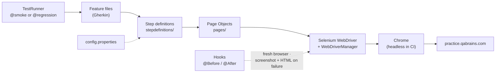

<div align="center">

# 🧪 QA Brains Automation — Java + Selenium

### Cucumber BDD UI suite for the QA Brains practice site — login, registration, password reset, e-commerce cart

[](https://git.io/typing-svg)

<!-- ============ STATUS BAR ============ -->
[](https://github.com/rbchy/QaBrainsAutomationJavaSelenium/actions/workflows/tests.yml)
-22c55e?style=for-the-badge&logo=checkmarx&logoColor=white)


</div>

---

## 📌 At a Glance

<table>
<tr>
<td width="50%" valign="top">

**🙋 What this is**

A Selenium + Cucumber suite for the **[QA Brains practice site](https://practice.qabrains.com/)**: user authentication (login, logout, registration, forgot password), the **e-commerce demo** (shop login, add / remove to cart, product details, product cards) and the sidebar demo modules. Scenarios are plain-English Gherkin, backed by **Page Objects** and run by **TestNG** through Maven.

Every push runs the whole suite in **GitHub Actions** with headless Chrome.

> *A test that doesn't fail when it should is worse than no test at all.*

</td>
<td width="50%" valign="top">

**📍 Quick facts**

| | |
|---|---|
| 🧪 **Scenarios** | 15 in 7 feature files |
| ✅ **CI** | 15 / 15 · headless Chrome · ≈ 4 min |
| 🏷️ **Tags** | `@smoke` · `@regression` · `@Cart` · `@Shop` … |
| 📸 **On failure** | Screenshot + page HTML in the report |
| ⚙️ **Config** | `src/test/resources/config.properties` |

</td>
</tr>
</table>

---

## ✅ Latest Results

| Feature file | Scenarios | Result |
|---|---:|---|
| 🔐 `Login.feature` | 2 |  |
| 🚪 `Logout.feature` | 1 |  |
| 📝 `Registration.feature` | 2 |  |
| 🔑 `ForgotPassword.feature` | 2 |  |
| 🛒 `CartCheckout.feature` | 2 |  |
| 🔄 `RegressionTests.feature` | 3 |  |
| 💨 `SmokeTests.feature` | 3 |  |
| **Total** | **15** | **100 %** |

<sub>GitHub Actions, Ubuntu, Temurin 17, headless Chrome ([workflow](.github/workflows/tests.yml)). The earlier local run in [QaBrainAutomationSeleniumCucumber.pdf](QaBrainAutomationSeleniumCucumber.pdf) shows 13 / 15 — its two cart failures are what the maintenance log below fixed.</sub>

---

## 🎯 Test Coverage

<details open>
<summary><strong>🔐 Authentication</strong></summary>

<br>

| Feature | Scenarios |
|---|---|
| Login | Valid credentials · invalid credentials show *"Your email and password both are invalid!"* |
| Logout | A logged-in user logs out and the login form returns |
| Registration | Register with a valid e-mail · the browser rejects an e-mail without `@` |
| Forgot Password | Reset for a registered e-mail · a malformed e-mail is rejected (*"missing an '@'"*) |

</details>

<details>
<summary><strong>🛒 E-commerce demo</strong></summary>

<br>

All shop scenarios first log in at `/ecommerce/login` with the public practice account.

| Scenario | Check |
|---|---|
| Add product to cart | The product's button turns into *Remove from cart* |
| Remove product from cart | Nothing is left marked *Remove from cart* |
| R-01 Add multiple products | 3 added → 3 in the cart |
| R-02 Product details | Details page shows the product name and price |
| R-03 Product cards | Every card has a name, a price and an *Add to cart* button |

</details>

<details>
<summary><strong>💨 Smoke</strong></summary>

<br>

| Scenario | Check |
|---|---|
| S-01 | Home page loads |
| S-02 | Registration, Forgot Password, Form Submission and Drag and Drop List open from the sidebar |
| S-03 | The E-Commerce demo site opens from the menu |

</details>

---

## 🏗️ Framework Architecture



- **Page Object Model** — `LoginPage`, `LogoutPage`, `RegistrationPage`, `ForgotPasswordPage`, `EcommercePage`
- **Explicit waits everywhere** — the shop waits for each cart click to change the product's state
- **Robust navigation** — the menu's element ids are generated on every load, so pages open by URL or visible label, never by those ids
- **Failure evidence** — screenshot and page HTML attached to the report and saved under `target/failures/`
- **Config, not code** — URL and the public practice accounts live in `config.properties`

---

## 🛠️ Tech Stack

| Layer | Technology | Version |
|---|---|---|
| Language | Java | 17 |
| Browser automation | Selenium WebDriver | 4.25.0 |
| Driver management | WebDriverManager | 5.7.0 |
| BDD | Cucumber JVM (Gherkin) | 7.15.0 |
| Runner | TestNG (`cucumber-testng`) | 7.9.0 |
| Build | Maven (Surefire 3.2.5) | — |
| Reporting | Cucumber HTML / JSON / JUnit XML | — |
| CI | GitHub Actions | — |

---

## 📁 Project Structure

```
QaBrainsAutomationJavaSelenium/
├── .github/workflows/tests.yml        ← headless run on every push
├── src/test/java/
│   ├── pages/                         ← Login, Logout, Registration, ForgotPassword, Ecommerce
│   ├── stepdefinitions/
│   │   ├── Hooks.java                 ← browser per scenario, failure evidence
│   │   ├── CommonSteps.java · AuthSteps.java
│   │   ├── RegistrationSteps.java · ForgotPasswordSteps.java
│   │   └── ShopSteps.java             ← cart, product details, menu navigation
│   ├── runners/TestRunner.java        ← @smoke or @regression
│   └── utils/
│       ├── BaseTest.java              ← config, Chrome options, headless switch
│       ├── DriverFactory.java         ← ThreadLocal driver, ready for parallel runs
│       └── DriverHelper.java
├── src/test/resources/
│   ├── config.properties
│   └── features/                      ← 7 feature files, 15 scenarios
├── QaBrainAutomationSeleniumCucumber.pdf
└── pom.xml
```

---

## ⚙️ Getting Started

**Prerequisites:** JDK 17+ · Maven 3.8+ · Google Chrome (WebDriverManager fetches the driver)

```bash
git clone https://github.com/rbchy/QaBrainsAutomationJavaSelenium.git
cd QaBrainsAutomationJavaSelenium

mvn clean test                                        # all @smoke or @regression scenarios
mvn clean test -Dheadless=true                        # what CI runs
mvn clean test -Dcucumber.filter.tags="@Cart"         # one area
```

From the IDE: right-click `runners/TestRunner.java` → **Run As › TestNG Test**.

| Report | Location |
|---|---|
| Cucumber HTML | `target/cucumber-reports.html` |
| JSON · JUnit XML | `target/cucumber-reports/` |
| Failure screenshots + page HTML | `target/failures/` and inside the HTML report |

---

## 🧹 Maintenance Log

| Change | Why |
|---|---|
| Cart scenarios rewritten for the site's real e-commerce demo | The old locators (`.add-to-cart`, `.cart-item`) came from a different shop — the 2 failures in the PDF |
| Smoke and regression steps now assert real behaviour | Several only printed text (e.g. *"Pages navigated correctly"*) and could never fail |
| Search, Catalog, Wishlist, Refer-a-Friend scenarios replaced | The practice site has none of these pages |
| Registration opens by URL | The menu's ids (`rc-menu-uuid-…`) change on every page load |
| Forgot Password no longer has its own `@Before` / `@After` | It quit the browser a second time after every scenario |
| Credentials from `config.properties`; another person's e-mail replaced in the feature files | No data in code; no third-party address in the tests |
| Headless switch and GitHub Actions | Every push is checked |
| Eclipse files and `.DS_Store` removed, ignored | IDE- and machine-specific |

---

## 📈 Roadmap

- [x] All scenarios assert real behaviour of the practice site
- [x] GitHub Actions with headless Chrome
- [ ] Form Submission and Drag and Drop scenarios
- [ ] Firefox and Edge in a CI browser matrix
- [ ] Parallel scenarios through the `ThreadLocal` `DriverFactory`
- [ ] Allure report published to GitHub Pages

---

## 🔗 Related Projects

| Project | Stack |
|---|---|
| 🔌 [API — Rest Assured](https://github.com/rbchy/QaBrainsAPIAutomationRestAssured) | Same site's UI plus a Rest Assured API pack — CI green |
| 🔬 [QA Brains — Java + Playwright](https://github.com/rbchy/QaBrainsAutomationJavaPlaywright) | Java 17 · Playwright · Cucumber JVM · TestNG |
| 🔌 [API — Postman / Newman](https://github.com/rbchy/QaBrainsAPIAutomation_Postman) | Postman · Newman — CI green |
| ⭐ [RbcTcsWorld E-Commerce Suite](https://github.com/rbchy/RbcTcsWorld_ECommerceSuite) | Spring Boot · REST Assured · Selenium · Playwright · CI quality gates |

<sub>All projects: [github.com/rbchy](https://github.com/rbchy)</sub>

---

## 👤 Author

<div align="center">

**Ranajit Baran Chowdhury (RB Chowdhury)**
QA Automation Engineer / SDET · West Norriton, Pennsylvania, USA

[](https://www.linkedin.com/in/rbchy/)
[](https://github.com/rbchy)
[](https://rbchy.github.io/rbchy/)
[](https://rbc6543.wixsite.com/rbc-portfolio)
[](mailto:chyranajit@gmail.com)

<sub>Licensed under MIT. QA Brains is a public practice site; only its published practice accounts are used.</sub>

⭐ *If this framework helps you, a star on the repo is appreciated.*

</div>
